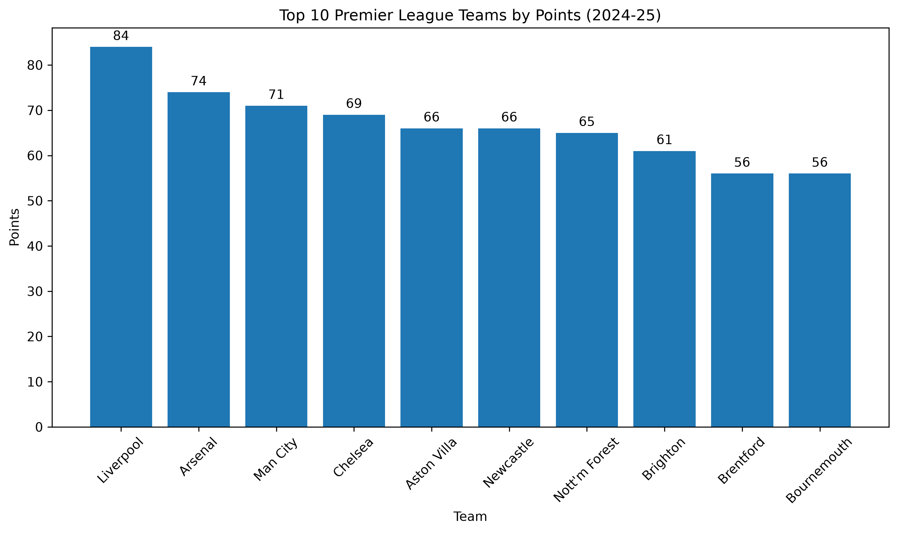

# Premier League Data Analysis (2024–25)

## Project Overview

This project analyzes the 2024–25 English Premier League season using Python and pandas. The goal is to explore team performance through goals scored, goals conceded, goal difference, wins, draws, losses, points, and win percentage.

## Tools & Technologies

- Python
- pandas
- NumPy
- Matplotlib
- Git and GitHub

## Key Findings

- Liverpool finished with 86 goals scored and 84 league points.
- Arsenal conceded the fewest goals among the teams, with 34.
- Liverpool recorded the highest goal difference, at +45.
- The dataset contains 380 Premier League matches.

## Visualization

### Top 10 Teams by Points

## Project Structure

- `data/raw/` — Original dataset
- `data/processed/` — Processed team statistics
- `src/` — Python analysis script
- `images/` — Saved charts
- `README.md` — Project documentation

## How to Run

1. Install Python.
2. Install the required libraries:

   `python -m pip install pandas numpy matplotlib`

3. Run the analysis from the project root:

   `python src/load_data.py`

## Disclaimer

This project is for educational and portfolio purposes. Please check the original dataset provider's terms before redistributing the raw data.

## Visualization

### Top 10 Teams by Points

